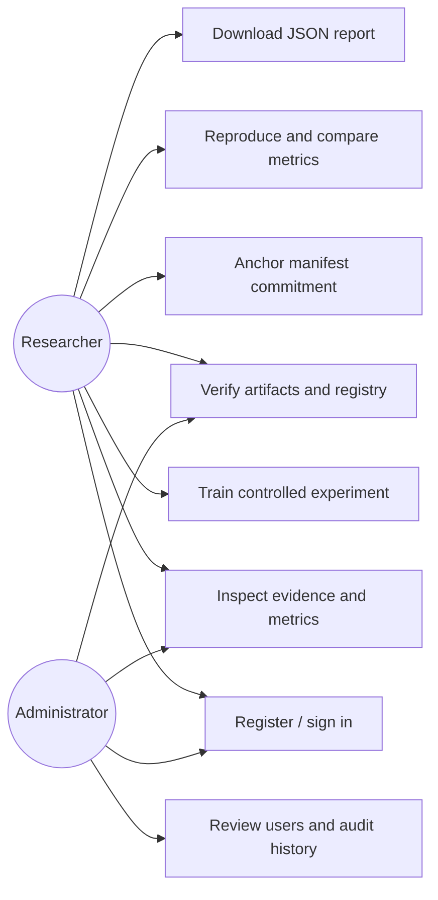
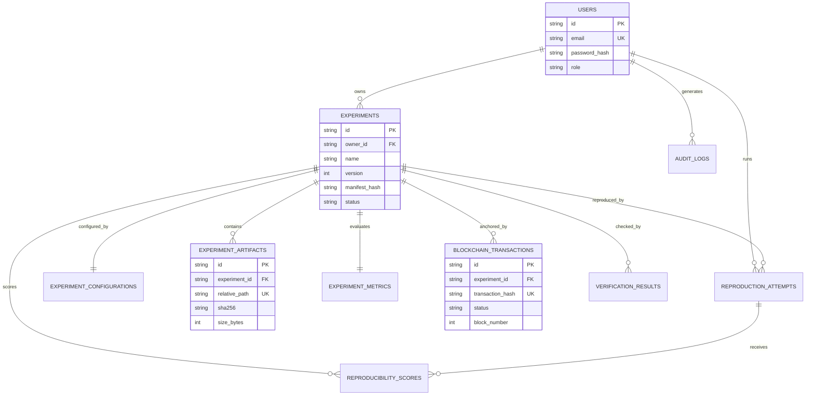

# Project overview and academic framework

## Problem statement

Machine-learning results are difficult to independently verify when the
dataset version, preprocessing, model parameters, random seeds, dependency
versions, and produced artifacts are incomplete or mutable. A database row or
published metric alone does not provide a tamper-evident commitment to the
specific evidence used in a run. Reproduction can also differ from the
original due to data, software, hardware, and nondeterministic execution
differences.

## Objectives

1. Record structured experiment configuration and evaluation outputs.
2. Hash experiment artifacts and a canonical manifest using SHA-256.
3. Keep large files off-chain and anchor only a compact manifest commitment.
4. Verify local artifacts independently from the on-chain commitment.
5. Rerun a controlled model pipeline and compare its metrics and environment.
6. Present a transparent, explicitly proposed reproducibility score.

## Related work

FAIR principles emphasize that research data should be findable, accessible,
interoperable, and reusable; this prototype addresses only a small portion of
the evidence and reuse problem and does not claim full FAIR compliance
[1]. The NeurIPS reproducibility checklist provides a practical set of
questions for reporting datasets, hyperparameters, evaluation, and compute;
the application records related fields but cannot replace scholarly review
[2]. National Academies guidance distinguishes reproducibility from
replicability and emphasizes transparent methods and data [3]. Versioned
artifacts and environment metadata are also familiar practices in tools such
as MLflow and DVC [4, 5]. A blockchain registry contributes a shared,
append-only commitment, but does not validate the contents or correctness of
the committed research.

## Proposed methodology

1. **Authentication and authorization:** create a user account, hash the
   password with a salted PBKDF2-HMAC-SHA-256 derivation, issue a short-lived
   signed bearer token, and scope private experiment access to its owner.
2. **Controlled experiment execution:** select one maintained scikit-learn
   model and a fixed, bundled dataset. Record the model parameters, seed,
   split procedure, dataset version, and runtime package versions. Uploaded
   Python is not executed.
3. **Evidence generation:** write the dataset representation, model,
   configuration, environment, metrics, source reference, and pipeline source
   snapshot to generated server-side paths. Compute SHA-256 hashes for each.
   Serialize the manifest using the versioned canonical JSON rules and hash
   those bytes.
4. **On-chain anchoring:** submit experiment UUID, version, and manifest
   digest to `ExperimentRegistry`; keep the account key server-side. Report
   confirmed only after a successful receipt and a matching contract read.
5. **Independent checks:** re-hash all recorded files and query the contract.
   Then run the fixed pipeline again, compare accuracy, precision, recall,
   F1, and ROC-AUC to configurable absolute tolerances, and compare environment
   metadata.
6. **Scoring:** assign weights of 40/20/30/10 to artifact integrity,
   configuration, metric agreement, and environment. Record every deduction
   reason; cap a score at 30 if critical integrity/anchoring evidence is
   missing or fails.

The score is an engineering heuristic to demonstrate explainable comparison.
It is not validated as a scientific measure and should not be used to rank
research studies.

## Architecture and data flow

See [architecture.md](./architecture.md) for the architecture and sequence
diagram. The principal trust boundaries are:

- The browser is an untrusted client and never receives the signing key.
- The API validates all request fields and creates artifact paths.
- Only fixed, reviewed pipeline code runs. User source is recorded as evidence,
  not executed.
- SQLite/PostgreSQL contains relational metadata; generated files remain on
  local disk.
- The local Hardhat chain verifies commitments but is not a public network or
  independent third-party service.

## Use-case diagram

## Database ER diagram

Remaining table fields and constraints are defined in the SQLAlchemy models.
The uniqueness constraint on `(owner_id, name, version)` prevents accidental
duplicate versions in one account.

## Implementation and test status

The implementation and reproducible commands are documented in the
[README](../README.md), [API reference](./api.md), and
[testing record](./testing.md). The testing record intentionally distinguishes
completed checks from checks still requiring a configured local environment.

## Limitations and future scope

The current worker is not container-isolated and in-process background jobs
are not crash-durable. The app does not accept arbitrary datasets, does not
replay arbitrary user preprocessing, stores artifacts on one local disk, and
does not validate scientific claims. A production extension should add a
durable queue and container sandbox, access-controlled object storage,
reviewed dataset ingestion, migrations operated by deployment automation,
stronger token lifecycle controls, and independent evaluation of the score.
IPFS, a public testnet, PDFs, and academic presentation/video deliverables are
not part of this local prototype.

## References

1. Wilkinson, M. D. et al. “The FAIR Guiding Principles for scientific data
   management and stewardship.” *Scientific Data* 3, 160018 (2016).
   https://doi.org/10.1038/sdata.2016.18
2. Pineau, J. et al. “Improving Reproducibility in Machine Learning Research
   (A Report from the NeurIPS 2019 Reproducibility Program).”
   *Journal of Machine Learning Research* 22(164), 1–20 (2021).
   https://jmlr.org/papers/v22/20-303.html
3. National Academies of Sciences, Engineering, and Medicine. *Reproducibility
   and Replicability in Science.* (2019).
   https://doi.org/10.17226/25303
4. MLflow documentation, “Tracking”.
   https://mlflow.org/docs/latest/ml/tracking/
5. DVC documentation, “Get Started”.
   https://dvc.org/doc/start

