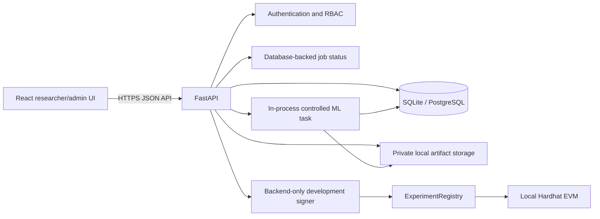
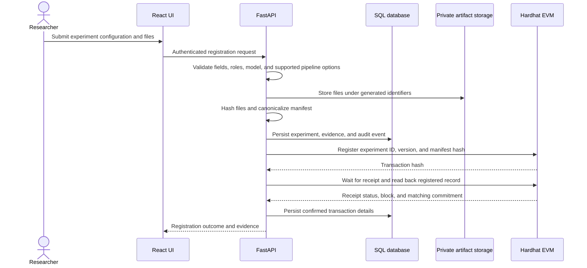

# Architecture proposal

## Design principles

1. Keep large and potentially confidential data off-chain.
2. Treat the canonical manifest hash as the on-chain commitment; keep the
   manifest and its referenced files in access-controlled local storage.
3. Verify a transaction from a mined receipt and contract read-back. A submitted
   transaction is not a successful registration.
4. Separate artifact integrity from scientific validity. Matching hashes prove
   that bytes match a commitment, not that an experiment is methodologically
   sound.
5. Execute only maintained, server-controlled training code. Never run
   researcher-uploaded Python source on the API server.
6. Make reproducibility scoring explicit, configurable, and explainable; it is
   a proposed project metric, not a scientifically universal measure.

## Component architecture



Training and reproduction job status is persisted before work starts, but the
current worker is an in-process FastAPI background task. It is not crash-durable
and is not container-isolated. A production worker should use a durable queue,
resource limits, restricted networking, and read-only inputs.

## Evidence and registration flow



The API must report a pending or failed state if receipt confirmation or
read-back fails. It must not synthesize transaction hashes, receipts, or
verification outcomes.

## Manifest canonicalization

The planned manifest format uses UTF-8 JSON with object keys sorted
lexicographically, no insignificant whitespace, and Unicode emitted directly
(`ensure_ascii=false`). Hash the resulting bytes with SHA-256. Arrays retain
their declared order. Hashes are lowercase hexadecimal with a `sha256:` prefix.
The canonicalization version will be included in the manifest so future format
changes do not silently change the meaning of existing evidence.

## Data ownership and trust boundaries

- The browser is an untrusted client; all validation and authorization happen
  server-side.
- The API process has access to application secrets and the local chain signing
  key in development. The key must come from an environment secret and must
  never be returned by an endpoint or committed to source control.
- Artifact paths are generated by the server, not derived from user-supplied
  paths. Access is checked for each download.
- The worker receives only validated configuration and the bundled dataset.
  Uploaded source code and datasets are not accepted; source references and a
  pipeline snapshot are recorded as evidence. User source is never executed.
- A local Hardhat chain is a development/demo environment, not a public
  blockchain or independent third-party attestation.

## Proposed project layout

```text
frontend/
  src/
    components/
    features/
    pages/
    api/
backend/
  app/
    api/
    auth/
    db/
    experiments/
    evidence/
    blockchain/
    jobs/
  migrations/
ml_engine/
  pipelines/
  schemas/
blockchain/
  contracts/
  scripts/
  test/
storage/
  .gitkeep
tests/
  backend/
  integration/
  e2e/
docs/
scripts/
docker/
```

## Persistence model

The relational database will contain users, experiments, artifacts,
configurations, metrics, blockchain transactions, reproduction attempts,
verification results, scores, and audit events. Foreign keys and uniqueness
constraints will enforce ownership and version identity. SQLAlchemy models and
Alembic migrations will keep SQLite development and PostgreSQL deployment
schemas aligned.

## API boundary

Planned API resources include `/auth`, `/experiments`, `/jobs`,
`/artifacts`, `/evidence`, `/blockchain`, `/reproductions`, `/verification`,
`/scores`, and `/reports`. OpenAPI documentation will be generated from
FastAPI schemas. Long-running model work will use persistent job state rather
than holding an HTTP request open.
